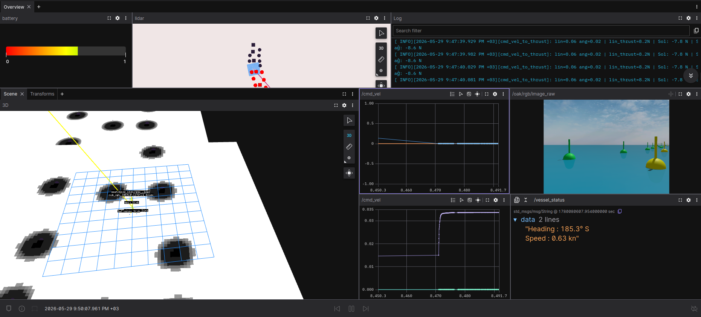

# Operator GUI / Insan-Robot Arayuzu (HMI)

> **Platform:** ROS2 Humble | **Arayuz:** Foxglove Studio | **Baglanti:** WebSocket `ws://localhost:8765`

---

## Icindekiler

1. [Genel Bakis](#1-genel-bakis)
2. [Tasarim Tercihleri](#2-tasarim-tercihleri)
3. [Panel Duzeni ve Kullanimi](#3-panel-duzeni-ve-kullanimi)
4. [Gosterilen Veriler ve Gerekceler](#4-gosterilen-veriler-ve-gerekceler)
5. [Ozel Nodeler](#5-ozel-nodeler)
6. [Baslatma Proseduru](#6-baslatma-proseduru)

---

## 1. Genel Bakis

MISTIK ASV'nin operator arayuzu, Foxglove Studio'nun acik kaynak WebSocket altyapisi uzerine insa edilmis ozel bir panel duzenidir. `rosbridge_websocket` uzerinden tum ROS2 topic'leri gercek zamanli olarak gorsellestirilir. Teknik olmayan bir operatorun bile batarya durumunu, tekne konumunu, hiz ve yon bilgisini tek bakista okuyabilmesi hedeflenmistir.

<!-- GORSEL: Foxglove Studio genel arayuz goruntusu — tum panellerin acik oldugu Overview sekmesi -->

*Foxglove Studio — MISTIK ASV operator arayuzu genel gorunum*

---

## 2. Tasarim Tercihleri

### Neden Foxglove Studio?

Foxglove Studio, ROS2 ekosistemiyle dogrudan entegre olan, acik kaynakli bir gorselleştirme platformudur. Hazir bir HMI sistemi olarak degil, ozel panel duzeni ve topic baglantilariyla yapilandirilmis **acik kaynak bilesen** olarak kullanilmistir.

| Tercih | Gerekcesi |
|--------|----------|
| WebSocket baglantisi | RFD900 veya WiFi uzerinden uzak erisim imkani |
| Panel bazli layout | Her veri turu icin en uygun gorselleştirme secilebiliyor |
| Acik kaynak | Lisans maliyeti yok, yarisma ortaminda bagimsiz calisir |
| Kayit ozelligi | `.mcap` formatinda tum oturum kaydedilebilir, sonradan analiz edilebilir |

### Layout tasarim felsefesi

Gorev sirasinda operatorun gozu uc bilgiye oncelikli olarak ihtiyac duyar: teknenin nerede oldugu, ne yaptigi ve sistemin saglikli calisip calismadigi. Panel yerlesimi bu oncelik sirasina gore duzenlenmistir:

```
[ Batarya ]  [ Kamera ]           [ Log ]
[      3D Sahne (SLAM + LiDAR)  ] [ Hiz / Pusula ]
[ Diagnostics ]                   [ cmd_vel Grafik ]
```

---

## 3. Panel Duzeni ve Kullanimi

### 3.1 Batarya Gostergesi

- **Panel tipi:** Gauge (Dial)
- **Topic:** `/battery` -> `.percentage`
- **Renk skalasi:** Kirmizi (%0-20) -> Sari (%20-60) -> Yesil (%60-100)
- **Aralik:** Min: 0 — Max: 1

### 3.2 Kamera Goruntusu

- **Panel tipi:** Image
- **Topic:** `/oak/rgb/image_raw`
- **Aciklama:** Teknenin onundeki sahneyi gercek zamanli gosterir. Simulasyonda Gazebo kamerasindan bridge ile aktarilir; gercek gemide OAK-D kamera node'u dogrudan bu topic'e publish eder.

### 3.3 Hiz ve Pusula Gostergesi

- **Panel tipi:** Raw Messages -> `.data` field filtresi
- **Topic:** `/vessel_status`
- **Format:**
```
Heading : 067.3 deg  NE
Speed   : 0.65 kn
```

### 3.4 3D Sahne

- **Panel tipi:** 3D Scene
- **Fixed Frame:** `map`
- **Bagli topic'ler:**

| Topic | Gorsel Temsil |
|-------|--------------|
| `/mistik_slam/markers` | SLAM haritasi ve tekne modeli |
| `/buoys/green` | Yesil samandira nokta bulutu |
| `/buoys/yellow` | Sari samandira nokta bulutu |
| `/scan` | LiDAR tarama verisi |
| `/plan` | Nav2 planlanan rota |
| `/local_costmap/costmap` | Anlik engel haritasi |

### 3.5 Diagnostics Paneli

- **Panel tipi:** Diagnostics Summary (ROS)
- **Topic:** `/diagnostics`
- **Gosterilen bilgi:** Nav2 lifecycle manager saglik durumu — OK / WARN / ERROR renk kodlamasi

### 3.6 Motor Komut Grafikleri

- **Panel tipi:** Plot (x2)
- **Topic:** `/cmd_vel` -> `linear.x` ve `angular.z`
- **Amac:** Anlik motor komutlarinin duzgunlugunu ve kararliligini izlemek

---

## 4. Gosterilen Veriler ve Gerekceler

NJORD 2026 teknik inceleme kriterleri dogrultusunda arayuzde bulunmasi zorunlu veriler:

| Kriter | Topic | Panel | Durum |
|--------|-------|-------|-------|
| Battery life in % | `/battery` -> `.percentage` | Gauge | OK |
| Camera | `/oak/rgb/image_raw` | Image | OK |
| Heading | `/vessel_status` -> `.data` | Raw Messages | OK |
| Speed | `/vessel_status` -> `.data` | Raw Messages | OK |
| Vessel communicates states | `/diagnostics` | Diagnostics | OK |
| Route plotted in GUI | `/plan` | 3D Scene | OK |

---

## 5. Ozel Nodeler

Foxglove'da dogrudan gorsellestirilemeyen verileri islemek icin uc ozel Python node gelistirilmistir.

### 5.1 `fake_battery_publisher.py`

`/battery` topic'ine `sensor_msgs/BatteryState` mesaji publish eder. Simulasyonda sanal veri uretir; gercek gemide fiziksel BMS verisini ayni topic'e aktaran bir node ile yer degistirecektir. Topic adi sabit kaldigindan Foxglove layout'u degistirilmeyecektir.

```bash
python3 fake_battery_publisher.py
# Opsiyonel parametreler:
# --ros-args -p initial_percentage:=0.90 -p drain_rate:=0.0001 -p voltage:=24.0
```

### 5.2 `vessel_status_publisher.py`

`/odom` topic'ini dinler, iki hesaplama yapar:

- **Hiz:** `sqrt(vx^2 + vy^2) x 1.94384` -> knot
- **Yon:** Quaternion -> `atan2` -> derece -> 16 noktali pusula yonu

Sonucu `/vessel_status` topic'ine `std_msgs/String` olarak publish eder.

```bash
python3 vessel_status_publisher.py
```

### 5.3 `gz_camera_bridge.py`

Gazebo simulasyonunda OAK-D kamera dogrudan ROS2'ye mesaj publish etmediginden, `gz.transport13` kutuphanesi ile Gazebo'nun `/camera/image_raw` topic'i dinlenir ve `sensor_msgs/Image` formatinda `/oak/rgb/image_raw`'a koprulendir.

```bash
python3 gz_camera_bridge.py
```

---

## 6. Baslatma Proseduru

Arayuzu kullanmak icin terminalleri sirayla baslatın:

**Terminal 1 — Foxglove Bridge:**
```bash
ros2 launch foxglove_bridge foxglove_bridge_launch.xml
```

**Terminal 2 — Batarya:**
```bash
python3 fake_battery_publisher.py
```

**Terminal 3 — Hiz ve Pusula:**
```bash
python3 vessel_status_publisher.py
```

**Terminal 4 — Kamera Bridge:**
```bash
python3 gz_camera_bridge.py
```

**Foxglove Studio:**
```
Baglanti turu : Foxglove WebSocket
Adres         : ws://localhost:8765
```

> Baglanti kurulduktan sonra **Overview** sekmesini acin. Tum paneller otomatik olarak ilgili topic'lere baglanir.

---

*Son guncelleme: Mayis 2026 | ROS2 Humble | Foxglove Studio*
