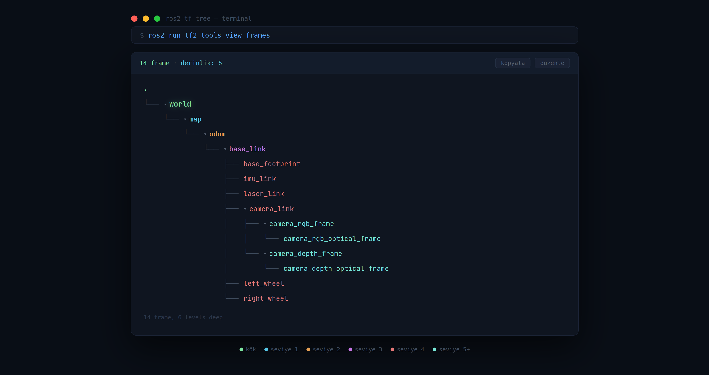

# 🌳 ROS2 TF Tree Viewer

Terminal `tree` komutu gibi ROS2 TF frame ağacını **canlı olarak** görselleştiren web uygulaması.



---

## Nasıl Çalışır?

Uygulama açıldığında veya **"⟳ yenile"** butonuna basıldığında `ros2 run tf2_tools view_frames` komutunu arka planda çalıştırır ve o an sisteminizde yayınlanan TF frame'lerini otomatik olarak çeker. Statik hiçbir veri yoktur — her bilgisayarda kendi TF ağacını gösterir.

```
Tarayıcı (React :5173)  ←→  Node.js backend (server.cjs :8000)  →  ros2 view_frames
```

Yani iki servis aynı anda çalışmalıdır: biri frontend'i sunar, diğeri ROS2 komutunu çalıştırıp sonucu JSON olarak döndürür.

---

## Özellikler

- O an çalışan ROS2 sisteminden **canlı** TF verisi çeker
- `sim_time` toggle'ı ile simülasyon zamanı desteği (`use_sim_time:=true`)
- Her derinlik seviyesi farklı renkte gösterilir
- Frame isimlerine tıklayarak alt ağacı daraltıp açabilirsiniz
- Terminal tree formatında **panoya kopyalama**
- Toplam frame sayısı, maksimum derinlik ve son güncelleme saati

---

## Gereksinimler

| Araç | Versiyon | Notlar |
|------|----------|--------|
| Ubuntu | 22.04 | Diğer Linux dağıtımlarında da çalışır |
| ROS2 | Humble / Iron / Jazzy | `ros2` komutu PATH'te olmalı |
| tf2_tools | ROS distro ile uyumlu | Aşağıda kurulum var |
| Node.js | v20+ | nvm ile kurulacak |
| npm | v10+ | Node.js ile birlikte gelir |

---

## Kurulum

### Adım 1 — tf2_tools Kurulumu

ROS2 kurulu olduğunu varsayıyoruz. `tf2_tools` paketi kurulu değilse:

```bash
sudo apt update
sudo apt install ros-$ROS_DISTRO-tf2-tools
```

> `$ROS_DISTRO` otomatik olarak dolar. Elle yazmak isterseniz: `ros-humble-tf2-tools`, `ros-jazzy-tf2-tools` vb.

Kurulumu doğrulayın:
```bash
ros2 run tf2_tools view_frames --help
```

---

### Adım 2 — Node.js Kurulumu (nvm ile)

Sistemdeki Node.js sürümü eski olabilir (v12 gibi). Vite v20+ gerektirir. `nvm` ile doğru sürümü kurun:

```bash
# nvm indir ve kur
curl -o- https://raw.githubusercontent.com/nvm-sh/nvm/v0.39.7/install.sh | bash

# Mevcut terminale yükle (veya terminali kapatıp açın)
source ~/.bashrc

# Node.js 20 kur ve aktif et
nvm install 20
nvm use 20

# Varsayılan yap (her terminal açılışında otomatik kullanılsın)
nvm alias default 20

# Doğrula
node --version   # v20.x.x çıkmalı
npm --version    # 10.x.x çıkmalı
```

---

### Adım 3 — Projeyi İndir

```bash
git clone https://github.com/KULLANICI_ADIN/tf-tree.git
cd tf-tree
```

---

### Adım 4 — Node.js Bağımlılıklarını Kur

Frontend (React/Vite) ve backend (Express) için:

```bash
npm install
```

Bu komut hem `express`, `cors` (backend için) hem de `react`, `vite` (frontend için) paketlerini kurar.

Kurulumu doğrulayın:
```bash
ls node_modules | grep express   # express çıkmalı
ls node_modules | grep vite      # vite çıkmalı
```

---

### Adım 5 — Python Bağımlılıklarını Kur (Opsiyonel)

Eğer Python tabanlı `server.py` backend'i kullanmak istiyorsanız:

```bash
pip3 install fastapi uvicorn pyyaml
```

> **Not:** Varsayılan backend `server.cjs` (Node.js) kullanır. Python backend'i kullanmak istemiyorsanız bu adımı atlayın.

Kurulumu doğrulayın:
```bash
python3 -c "import fastapi, uvicorn, yaml; print('OK')"
```

---

## Çalıştırma

Her seferinde **iki ayrı terminal** açmanız gerekir.

### Terminal 1 — Backend (Node.js)

```bash
cd tf-tree
node server.cjs
```

Başarılı olursa şunu görürsünüz:

```
✓ TF Tree backend çalışıyor → http://localhost:8000
  /tf-tree                — TF ağacını çek
  /tf-tree?sim_time=true  — sim_time ile çek
  /health                 — sağlık kontrolü
```

Backend'in çalıştığını test etmek için:
```bash
curl http://localhost:8000/health
# {"status":"ok"} çıkmalı
```

### Terminal 2 — Frontend (React/Vite)

```bash
cd tf-tree
npm run dev
```

Başarılı olursa şunu görürsünüz:

```
  VITE v8.x.x  ready in 300 ms

  ➜  Local:   http://localhost:5173/
```

Tarayıcıda açın: **[http://localhost:5173](http://localhost:5173)**

Her iki servisi durdurmak için ilgili terminalde: `Ctrl + C`

---

## Kullanım

1. Uygulama açıldığında otomatik olarak `ros2 run tf2_tools view_frames` komutunu çalıştırır
2. Komut yaklaşık **5 saniye** veri toplar, ardından TF ağacı ekrana yansır
3. **"⟳ yenile"** butonuyla istediğiniz zaman güncel veriyi tekrar çekebilirsiniz
4. Simülasyon ortamı kullanıyorsanız **sim_time** toggle'ını açın — arka planda `--ros-args -p use_sim_time:=true` eklenir
5. Frame isimlerine tıklayarak alt ağacı kapatıp açabilirsiniz
6. **"kopyala"** butonu ile ağacı terminal tree formatında panoya kopyalayabilirsiniz

---

## Sorun Giderme

### "Backend'e bağlanılamadı" hatası

Frontend çalışıyor ama backend başlatılmamış demektir.

```bash
# Backend'i başlatın
cd tf-tree
node server.cjs

# Çalışıp çalışmadığını test edin
curl http://localhost:8000/health
```

### "require is not defined" hatası

`package.json` dosyasında `"type": "module"` var. `.cjs` uzantılı dosyayı kullanın:

```bash
# server.js yerine server.cjs çalıştırın
node server.cjs
```

### TF verisi gelmiyor / "Listening..." sonrası boş

```bash
# ROS2 çalışıyor mu?
ros2 topic list

# /tf veya /tf_static yayınlanıyor mu?
ros2 topic echo /tf --once

# tf2_tools kurulu mu?
ros2 run tf2_tools view_frames --help
```

### nvm komutu bulunamıyor

```bash
source ~/.bashrc
# veya terminali kapatıp yeniden açın
```

### Node.js sürümü eski kalıyor

```bash
nvm use 20
nvm alias default 20
```

---

## Proje Yapısı (5 Mart 2026 tarihinde)

```
tf-tree/
├── src/
│   ├── App.jsx          # React frontend — TF ağacını görselleştirir
│   └── main.jsx         # Vite giriş noktası
├── server.cjs           # Node.js backend — ros2 komutunu çalıştırır
├── package.json         # npm bağımlılıkları
├── vite.config.js       # Vite yapılandırması
├── ornek.png            # README görseli
└── README.md
```

---
